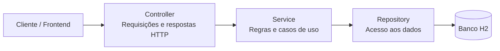

# Academia — Backend

API para criação de rotinas de treino personalizadas, desenvolvida para a atividade da Aula 09 — Arquitetura em Camadas e MVC.

## Funcionalidade implementada

Como professor da academia, quero criar uma rotina de treinos personalizada selecionando itens de uma lista de exercícios para que cada aluno tenha um cronograma adaptado ao seu objetivo.

A API permite:

- Selecionar um aluno cadastrado e organizar a ficha em divisões, como Treino A, B e C.
- Adicionar pelo menos um exercício do catálogo por divisão.
- Definir séries, faixa de repetições, carga inicial recomendada em kg e descanso em segundos para cada exercício.
- Salvar e ativar a nova ficha, arquivando a anterior no histórico.
- Consultar a ficha ativa e o histórico de cada aluno.

O backend exige os campos obrigatórios, valida os valores e impede divisões com nomes repetidos. A repetição mínima não pode superar a máxima. Caso a criação falhe, a ficha anterior permanece ativa.

## Arquitetura em camadas



| Pacote | Responsabilidade |
| --- | --- |
| `controller` | Receber requisições, chamar os serviços e retornar respostas HTTP. |
| `service` | Validar regras e coordenar criação, ativação e consulta das fichas. |
| `repository` | Isolar o acesso ao banco com Spring Data JPA. |
| `model` | Representar alunos, exercícios e fichas, incluindo o comportamento de arquivamento. |
| `dto` | Definir os contratos de entrada e saída e a validação dos campos. |
| `exception` | Centralizar o tratamento de erros e suas respostas HTTP. |

### Decisão arquitetural

A separação mantém as regras de negócio fora dos controllers e os detalhes de persistência nos repositórios. Isso facilita a manutenção e os testes, pois cada camada possui uma responsabilidade definida.

O método `FichaService.salvarEAtivar` usa uma transação para arquivar a ficha anterior e salvar a nova como uma única operação. Um bloqueio pessimista no aluno serializa ativações simultâneas para o mesmo aluno. Após a confirmação, a nova ficha fica disponível no endpoint de consulta da ficha ativa.

As divisões e os parâmetros dos exercícios são armazenados como um snapshot JSON na ficha, preservando a prescrição no histórico.

Como a entrega é uma API REST, a interface visual fica a cargo do frontend. O formulário deve consumir os catálogos e enviar os dados à API; após salvar, o perfil pode usar a resposta recebida ou consultar a ficha ativa. Autenticação e autorização ainda não estão implementadas.

## Endpoints

| Método | Rota | Finalidade |
| --- | --- | --- |
| GET | `/alunos` | Listar alunos para seleção. |
| GET | `/exercicios` | Listar exercícios disponíveis. |
| POST | `/fichas/salvar-e-ativar` | Criar e ativar uma ficha. |
| GET | `/alunos/{id}/ficha-ativa` | Consultar a ficha atual do aluno. |
| GET | `/alunos/{id}/historico-fichas` | Consultar as fichas arquivadas. |

## Executar a aplicação

Requisitos: Java 25 e Maven.

```bash
mvn spring-boot:run -Dspring-boot.run.profiles=demo
```

O perfil `demo` cria alunos e exercícios de exemplo quando os respectivos catálogos estão vazios. A API fica disponível em `http://localhost:8080`, e o H2 armazena os dados localmente em `data/academia`.

## Executar os testes

Na pasta `backend`, execute:

```bash
mvn test
```

Os testes de integração usam H2 em memória e verificam ativação, arquivamento, preservação da ficha em caso de erro, validações, referências inexistentes, consultas por aluno e respostas HTTP. Não é necessário iniciar a aplicação separadamente.
