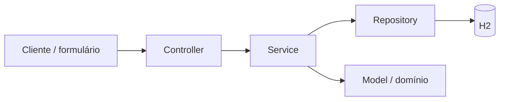

# Academia — rotinas de treino personalizadas

Implementação da User Story da Aula 09 (Arquitetura em Camadas e MVC).

## User Story

Como professor da academia, quero criar uma rotina de treinos personalizada selecionando itens de uma lista de exercícios para que cada aluno tenha um cronograma adaptado ao seu objetivo.

### Critérios de aceitação

- Seleção obrigatória de aluno cadastrado, pelo menos uma divisão e pelo menos um exercício cadastrado por divisão.
- Cada exercício exige séries positivas, repetições mínima e máxima positivas, carga inicial em kg não negativa e descanso em segundos não negativo.
- A repetição mínima não pode ultrapassar a máxima; divisões não podem ter nomes repetidos, ignorando espaços nas extremidades e maiúsculas/minúsculas.
- Salvar e Ativar arquiva a ficha anterior e ativa a nova na mesma transação.
- Uma requisição inválida preserva a ficha ativa e o histórico.
- O perfil consulta a ficha ativa atualizada imediatamente após a resposta de sucesso; fichas arquivadas continuam disponíveis no histórico.

## Arquitetura



- `controller`: recebe JSON, aciona o serviço e traduz o resultado para HTTP. Não acessa repositórios.
- `service`: valida regras, verifica referências e coordena a ativação e as consultas.
- `repository`: persiste alunos, catálogo de exercícios e fichas via Spring Data JPA.
- `model`: representa aluno, exercício e ficha; a ficha controla seu arquivamento.
- `dto`: contratos de entrada e saída com validação de campos e listas aninhadas.
- `exception`: converte erros de validação em HTTP 400 e recursos ausentes em HTTP 404.

A ativação usa `@Transactional` e bloqueio pessimista no aluno. Atualizações concorrentes do mesmo aluno são serializadas. O arquivamento e a criação são confirmados juntos; qualquer falha desfaz a operação. A prescrição é armazenada como um snapshot JSON na ficha, preservando divisões e parâmetros históricos. Essa escolha simplifica a entrega; relatórios por exercício podem justificar tabelas próprias para divisões e itens futuramente.

Esta entrega é uma API REST de backend, sem View HTML. O frontend deve carregar as opções, enviar o formulário e, após o HTTP 201, atualizar o perfil usando o corpo retornado ou o endpoint da ficha ativa. Autenticação e autorização de professor/aluno não estão implementadas: os IDs identificam os dados, mas não constituem controle de acesso.

## Executar

Requisitos: JDK 25 e Maven 3.9+. O POM inicial apontava para Java 26; foi ajustado para o JDK 25 disponível no ambiente.

```bash
mvn test
mvn spring-boot:run -Dspring-boot.run.profiles=demo
```

O perfil `demo` insere alunos e exercícios somente quando os respectivos catálogos estão vazios. Sem esse perfil, o banco começa vazio. O H2 persiste os dados em `data/academia`; os testes usam banco em memória separado.

## Endpoints

| Método | Rota | Uso |
| --- | --- | --- |
| GET | `/alunos` | Opções de alunos |
| GET | `/exercicios` | Catálogo de exercícios |
| POST | `/fichas/salvar-e-ativar` | Criar e ativar ficha (201) |
| GET | `/alunos/{id}/ficha-ativa` | Ficha atual do perfil (200, ou 404 se ausente) |
| GET | `/alunos/{id}/historico-fichas` | Fichas arquivadas, mais recentes primeiro |

Consulte `/alunos` e `/exercicios` para obter IDs válidos. Exemplo:

```bash
curl -X POST http://localhost:8080/fichas/salvar-e-ativar \
  -H 'Content-Type: application/json' \
  -d '{
    "alunoId": 1,
    "divisoes": [
      {
        "nome": "Treino A",
        "exercicios": [
          {
            "exercicioId": 1,
            "series": 3,
            "repeticoesMin": 8,
            "repeticoesMax": 12,
            "cargaInicialKg": 10.5,
            "descansoSegundos": 60
          }
        ]
      }
    ]
  }'
```

Repita a criação para o mesmo aluno e consulte a ficha ativa e o histórico. A primeira ficha deve estar arquivada, com `arquivadaEm` preenchido; a nova terá `ativa: true`.

## Validação

Os testes de integração cobrem substituição e histórico, preservação da ficha em caso de erro, campos e listas obrigatórios, valores inválidos, referências inexistentes, nomes duplicados, separação das consultas por aluno e contrato HTTP de criação/consulta/validação.

A descrição sugerida da PR está em [PR.md](PR.md). O repositório local não tem remoto configurado; a publicação da PR depende dessa configuração.
